<p align="center">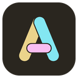</p>

# Aldune

**Notes on the edge of your screen.** Aldune is a sticky-notes app for Windows: your notes live as a
deck of tabs on one edge of the screen, fan out when you hover over them and open as windows of
their own. No account, no required cloud, and the content is encrypted.

[Español](README.md)

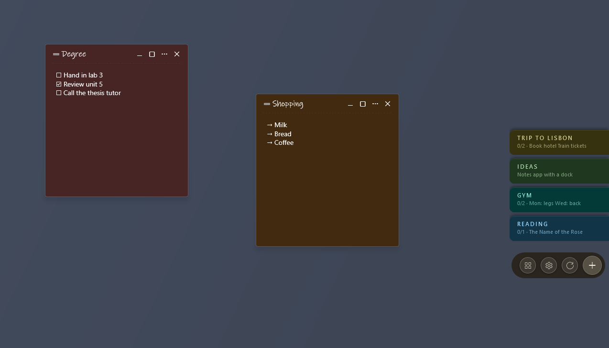

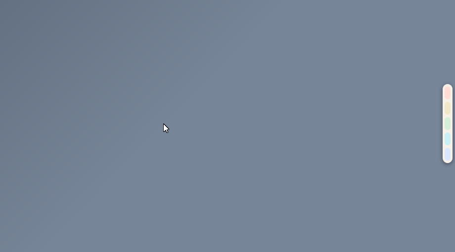

## What it does

- **A dock on the edge of the screen**, on any of the four edges, on every screen or just one. It
  hides by itself during full-screen games and videos.
- **Tasks and lists** inside each note (`Ctrl+L`, `Ctrl+Shift+L`), with indentation, and an option to
  remove completed tasks after a while.
- **Reminders**, **tags**, **archive** and **trash**, plus a manager to search and organize.
- **Color themes**: Classic, Serene and Graphite, with light, dark or alternating notes, or your own.
- **A global shortcut** to create a note from anywhere (`Ctrl+Shift+N` by default).
- **Password-protected notes**, encrypted with a key derived from the password (which is not stored), with an optional visible name to recognize them without opening them.
- **Optional sync** between devices through a shared folder or NAS, your own server (Docker) or
  WebDAV / Nextcloud, end-to-end encrypted. See [docs/SYNC.md](docs/SYNC.md) (in Spanish).
- **Automatic backups**: one a day, the 7 most recent are kept.
- **Accessible**: a visible focus ring when navigating with Tab, note colors chosen with the arrow keys, “Text size” (100–150 %) and per-note zoom with
  `Ctrl` + mouse wheel, and Windows high contrast. The dock opens with the mouse; without one, the optional `Ctrl+Alt+M` shortcut (Settings → General)
  opens the notes list (Enter opens a note, Space selects it). More in “Quick help” in Settings.
- In **English**, **Spanish**, **German**, **French** and **Brazilian Portuguese**.

### Looks

Besides Dark, Light, Pastel and Midnight there are looks with a character of their own (on Android too). Three of the newest: the **travel notebook** (cream paper with folds), the **field notebook** (ruled lines and a red margin) and the **graph-paper notebook** (squared sheet with a red margin; coming in the next version), each in light and dark.

| Travel notebook | Field notebook | Graph-paper notebook |
|---|---|---|
| 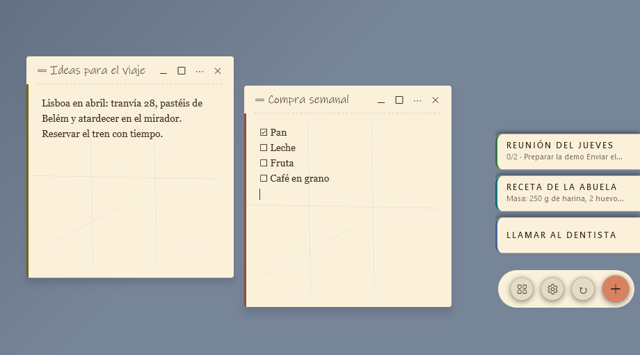 | 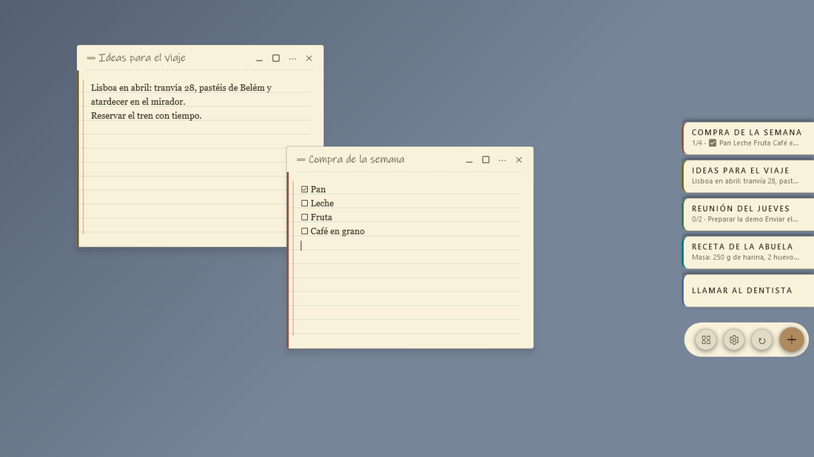 | 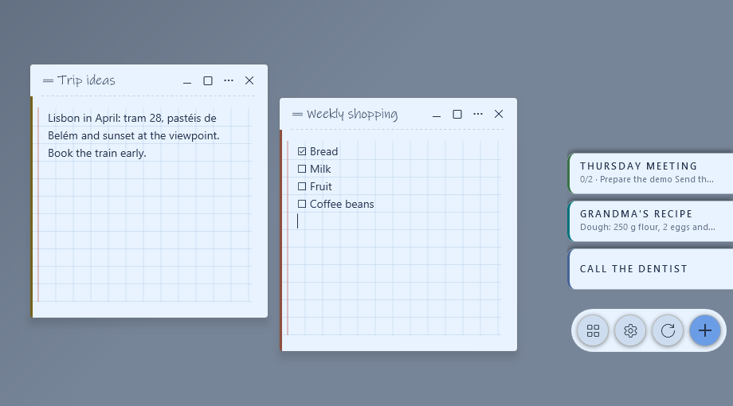 |
| 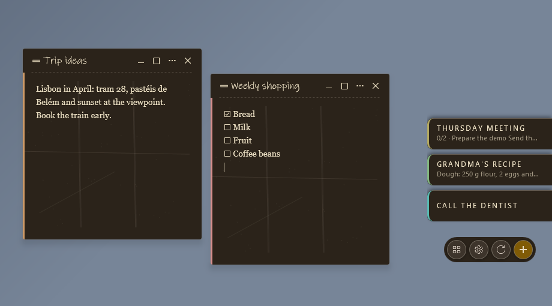 | 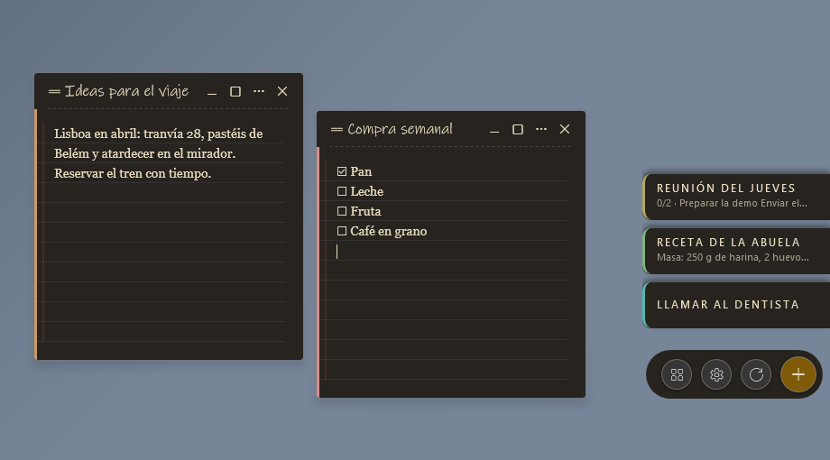 | 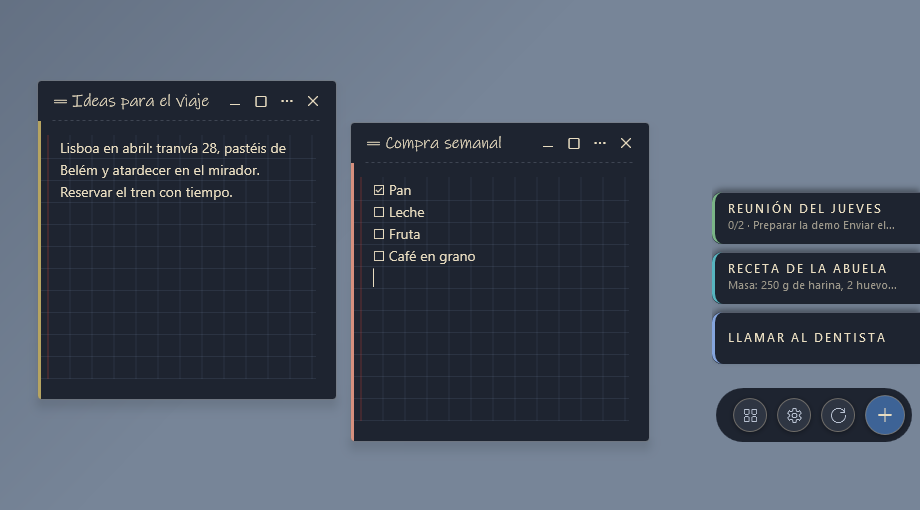 |

## Install

Download the latest version from [Releases](https://github.com/NachoPola16/aldune/releases):

- **Installer** (`Aldune-Setup-x.y.z.exe`): shortcuts and an uninstaller. No administrator rights
  needed. Uninstalling does not delete your notes.
- **Portable** (`aldune-portable-win-x64.zip`): a single `aldune.exe`, nothing to install.
- **Portable for ARM** (`aldune-portable-win-arm64.zip`): the same for Windows on ARM64 (Surface Pro X, Snapdragon laptops). The x64 builds also
  run there, emulated; this one is native.
- **`SHA256SUMS.txt`**: the SHA-256 hash of every file in that release, to check that what you downloaded is exactly what was published.

Requirements: 64-bit Windows 10 or 11. You don't need to install .NET.

**Check your download** (optional, in PowerShell). The result must equal that file's line in `SHA256SUMS.txt`:

```powershell
(Get-FileHash .\Aldune-Setup-2.1.3.0.exe -Algorithm SHA256).Hash.ToLower()
```

It catches a corrupted download or one altered on the way. It is not a substitute for code signing (see "Signing and privacy"): anyone who could
change the file on GitHub could change its hash too.

If Windows shows "Windows protected your PC", it's because the executable isn't signed yet: click
"More info" and "Run anyway".

## Android

<p align="center">
  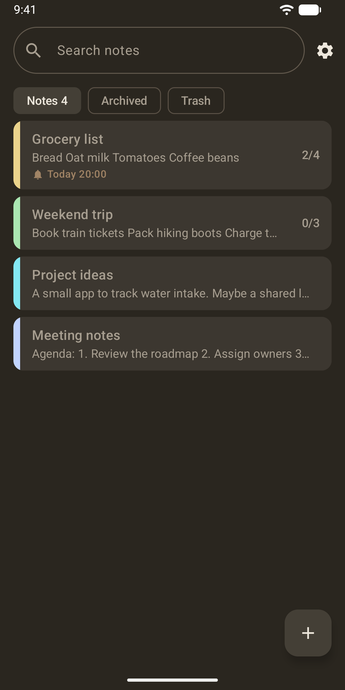
  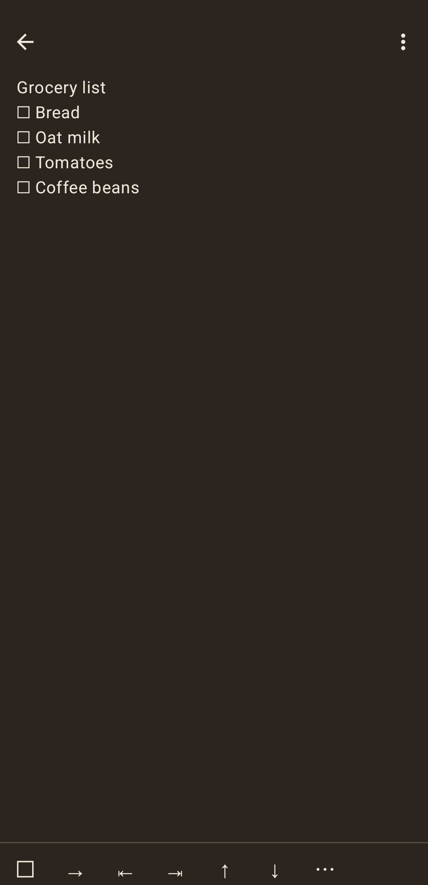
  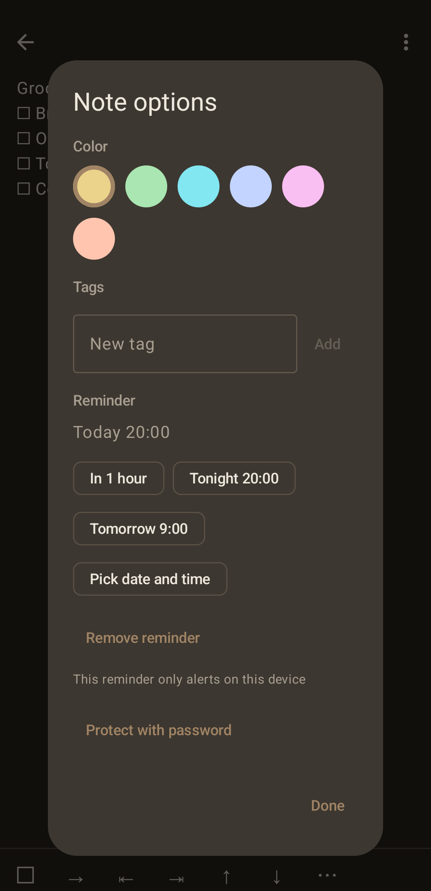
</p>

There is an Android client (native Kotlin, Android 8 or later) in [`android/`](android/): notes with task lists, tags,
password-protected notes, reminders, a widget and quick capture, and the same end-to-end encrypted sync as on Windows.
To install it, download the signed APK from [Releases](https://github.com/NachoPola16/aldune/releases) (the `android-v…` ones; each release's notes carry the APK's SHA-256 and the signing certificate's fingerprint) and open it on your phone.

**Something like the dock on Android.** A phone has no screen edge to stick tabs to as on Windows, but there are two ways to keep
your notes within reach: the **widgets** (the deck at 4×2, 2×2 or 4×4, and a 1×1 new-note button) and, since **Android 17**, the
**bubble**: long-press the Aldune icon in your launcher and choose the bubble option. The app floats over any other app, folds
into an icon you can drag to a screen edge, and opens with one tap without leaving what you were doing. It is a system feature
(Aldune needs to do nothing); the exact name of the option depends on the launcher.

To sync your phone with your PC and your server:

1. In Aldune for Windows: Settings → Sync → **Share profile**, and copy the code (`aldune-profile-v2:…`).
2. Send it to your phone (a message to yourself, for example).
3. In the Android app: Settings → Sync, paste the code and tap **Continue**.
4. Type your server's **token**. It is deliberately not inside the code.

The code contains the encryption key of your notes: treat it like a password and do not share it in public places.
More detail in [docs/SYNC.md](docs/SYNC.md).

## Privacy and security

Your notes are stored in `%LOCALAPPDATA%\Aldune`, on your computer. The text of each note is
encrypted with AES-256-GCM, and the key is protected by your Windows user. Aldune has no account and
no server of its own. The only things that leave your computer are sync, if you turn it on (and
only to the storage you choose), and a daily request to GitHub to tell you about new versions
(you can turn it off in Settings → General).

Sync encrypts the content before it leaves your computer: the storage can't read your notes or
fabricate changes to them. The details, including what it does **not** protect, are in
[docs/SYNC.md → Modelo de seguridad](docs/SYNC.md#modelo-de-seguridad).

## Signing and privacy

The installer and the executable are **not signed** yet, so Windows SmartScreen may warn about an
"unknown publisher" when you open them: click "More info" → "Run anyway". They are built by GitHub
Actions from this public repository (`.github/workflows/release.yml`).

Privacy: this program will not transfer any information to other networked systems unless
specifically requested by the user or the person installing or operating it. The two exceptions
are opt-in or can be turned off: sync, which only runs if you set it up and only talks to the
storage you choose, and the daily check for new versions, which asks GitHub for the list of
releases, sends nothing about you or your notes, and can be turned off in Settings → General.

## Build from source

On Windows with the .NET 10 SDK:

```powershell
dotnet build Aldune.slnx -c Release
dotnet test Aldune.slnx -c Release
./scripts/build-installer.ps1   # portable and installer in dist/ (needs Inno Setup 6)
```

How a version is released and signed: [docs/RELEASING.md](docs/RELEASING.md).

## Try it and give feedback

If you are testing it: Windows [v2.1.3](https://github.com/NachoPola16/aldune/releases/tag/v2.1.3), Android [1.0.1](https://github.com/NachoPola16/aldune/releases/tag/android-v1.0.1).
A bug, a question or an idea goes to [Issues](https://github.com/NachoPola16/aldune/issues/new): say which version you use, what you did and what you expected.
Do not paste profile codes, tokens or the contents of your notes in a public issue.

## How it is made

Aldune is developed by one person with the help of AI assistants. The author reviews, tests and maintains the code, and it is open so you can check it yourself.

## License

[GPL-3.0](LICENSE). You can use, study, modify and share Aldune; if you distribute a modified
version, it has to remain free under the same license.
