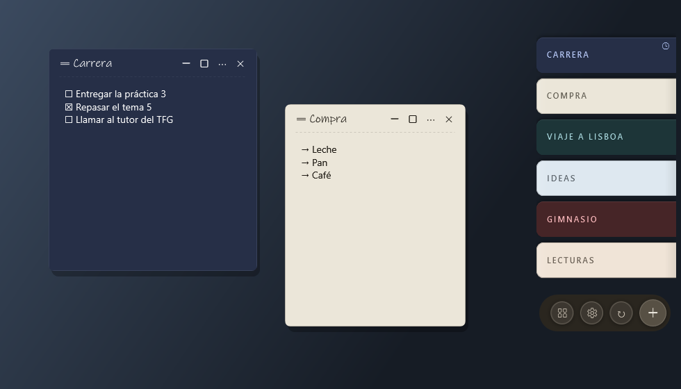

# How Aldune got here

Aldune started at the end of August 2026 as a small idea: sticky notes that live on the edge of the screen, with nothing to sign up for. This page is the short story of what it has become since, written for the people who use it (or might): what you can see, what you can trust, and the bugs that bit real users and how they were fixed. The full technical record is in [`STATUS.md`](STATUS.md); what was decided *not* to do is in [`ROADMAP.md`](ROADMAP.md).

## Then and now

| Windows 1.0.0 (24 September 2026) | Windows today |
|---|---|
|  |  |

The first screenshot uses Spanish sample notes because that is what the app was tested with at the time. Since then the dock got a quieter button bar, a text preview on each tab, pinned notes, tags and reminders on the tabs, and more than a dozen looks instead of one (the notebook looks are in the [README](../README.md#looks)).

## At a glance

| | Today |
|---|---|
| Platforms | Windows and Android (native Kotlin, not a wrapper) |
| Sync | your own server, a shared folder or WebDAV / Nextcloud, end-to-end encrypted |
| Languages | English, Spanish, German, French, Italian, Brazilian Portuguese, Japanese (1.0.0 had English and Spanish) |
| Looks | dark, light, pastel, midnight, XP, Telecom, Bash, Phosphor and six notebook looks (1.0.0 had a single dark look) |
| Tasks | checklists with tick boxes, per-note rules for done tasks, progress on the tab and in the Android widget |
| Safety net | automatic backups, local version history per note, password-protected notes |

## The road, release by release

- **0.5 → 0.10 (September 2026).** The dock, the note windows, the archive and trash, a notes manager, and a first sync. Most of this stretch was about making the dock behave: not disappearing on you, remembering which screen it lives on, and surviving monitors being plugged in and out.
- **1.0 (24 September).** Note themes, sync where *deletions are signed* (a delete that cannot be verified never erases anything), automatic backups, a dock that finds its way back to its screen, and a new logo.
- **1.1 (26 September).** Tasks and lists: Ctrl+Enter to tick, uncheck all for a weekly shopping list, move done tasks to the end, paste a Markdown list and get its boxes, pending tasks in the reminder.
- **1.2–1.4 (27 September).** Sync stopped resending what it had just received and inventing conflicts. The manager gained text, dates and tags. Light, pastel and midnight looks; the interface in German, French and Brazilian Portuguese (installer included).
- **1.5–1.7 (October).** Linked files (edit a `.md` or `.txt` file as a note without Aldune ever deleting it), sounds for events, and a long run of fixes from daily use.
- **Android (24 to 29 October).** Eleven release candidates, then 0.1.0 and 1.0.0: a native Kotlin app with the same encrypted sync format, a home-screen widget, a quick-capture notification and tile, reminders, and pairing with the PC by scanning a QR code.
- **2.0 (29 October).** An optional visible name for protected notes, and the "definitive" polish round.
- **2.1 (30 October).** The travel, field and graph-paper notebook looks, with paper under the text; paper-and-pen sounds; the same Settings layout on both platforms; a full accessibility pass (visible keyboard focus, keyboard-only dock with Ctrl+Alt+D).
- **2.2 / Android 1.1 (31 October).** Pinned notes that sync, and a long list of details found by using the app.
- **Next (2.3 / Android 1.2, in the tree).** A per-note rule for done tasks (so a shared shopping list is never emptied by another device), local version history, Android tag tools, the mouse wheel to switch dock views, a quieter button bar on the dock, Italian and Japanese.

## Bugs that mattered, and what changed

These are the ones a person using Aldune could actually notice. None of them is hidden: each one has a test or a probe so it does not come back.

- **Sync that invented conflicts (fixed in 1.2).** Two devices could end up arguing about a note neither had changed. Versions now carry their author and a last common version, and the engine has scenario tests for it.
- **Deletes that could take notes with them (fixed in 1.7.18 / 0.1.1).** An unsigned delete arriving from a server can no longer remove a note.
- **Credentials sent somewhere they should not go (fixed in 1.7.18 / 0.1.1).** On Android, WebDAV now refuses an address that changes host before sending the password. A pairing code or QR with a misleading address is rejected, and plain `http` outside your home network asks for confirmation.
- **Tapping a checkbox opened the keyboard (Android, fixed in 0.1.1).** A tap on a box no longer moves the cursor or pops up the keyboard.
- **A note covering the dock (fixed in 2.1.2).** A note dragged over the resting dock could hide it and you could not tell where the edge was.
- **A tray menu with unreadable text in the light XP look (fixed in 2.1.4).** Dark body, beige strip, illegible "Exit".
- **A pin that vanished on a key change (fixed before 2.2).** Re-keying a sync profile dropped optional fields such as the pin; now covered by a test.
- **A task you could not tick (fixed in the 2.3 round).** A dash glued to the box (`☐-`) made the line stop being a task. Now a sign next to the box still counts, and the space behind it is protected.
- **A dock that scrolled in jumps (fixed in the 2.3 round).** The mouse wheel moved a whole tab at a time and the middle-click autoscroll ran at an irregular rate; both are now smooth.

## What keeps it trustworthy

- Everything that leaves the device is encrypted with AES-GCM, deletions included. The server only ever sees encrypted data.
- Two passes aimed at security, plus several rounds of code review, with every finding checked against the code before it was fixed.
- More than 2,000 automated tests, and the interface is checked with disposable probes that open real windows and take screenshots.
- No account, no ads, no trackers. Without sync, your notes never leave the device.

## What is next

See [`ROADMAP.md`](ROADMAP.md). The short version: publish the 2.3 / 1.2 round, find out from real users what is missing, and keep the data format stable so that every version installed keeps working with the others.
