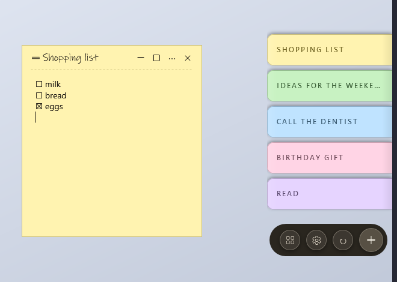
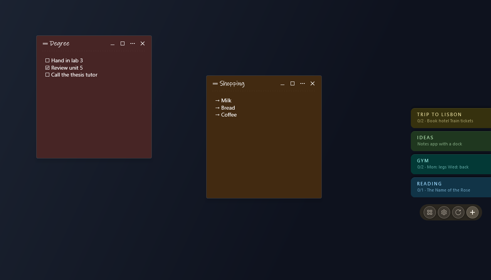
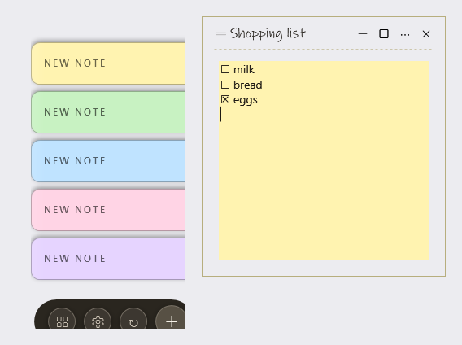
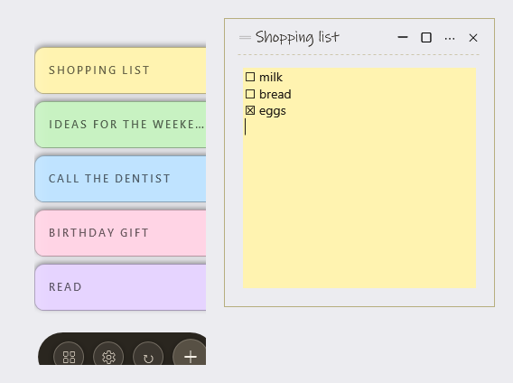
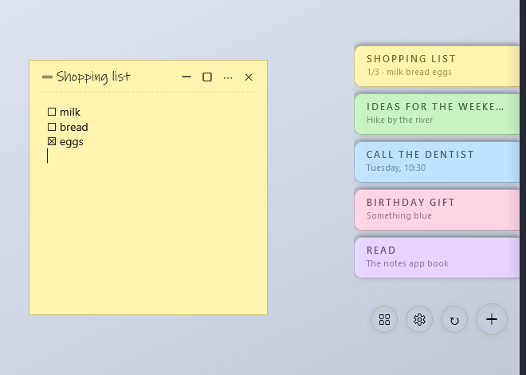
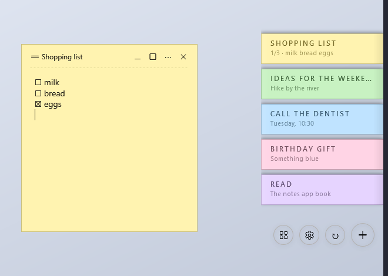
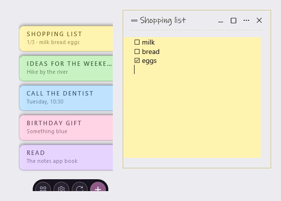
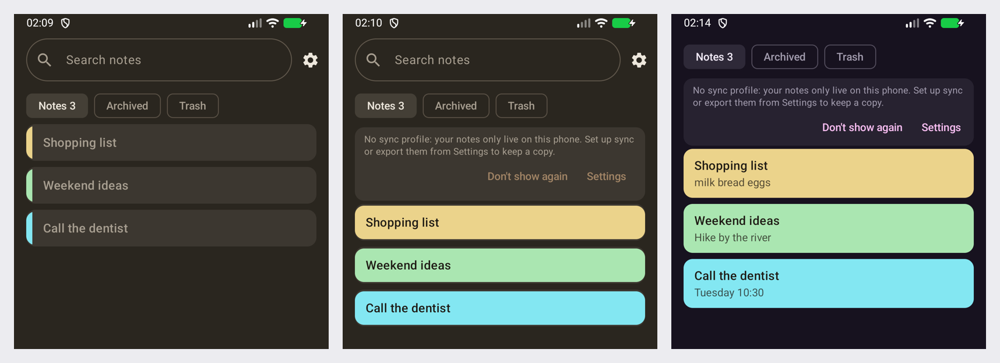

# How Aldune got here

Aldune started at the end of August 2026 as a small idea: sticky notes that live on the edge of the screen, with nothing to sign up for. This page is the short story of what it has become since, written for the people who use it (or might): what you can see, what you can trust, and the bugs that bit real users and how they were fixed. The full technical record is in [`STATUS.md`](STATUS.md); what was decided *not* to do is in [`ROADMAP.md`](ROADMAP.md).

## Then and now

| Windows 1.0.0 (24 September 2026) | Windows today |
|---|---|
|  |  |

The first screenshot uses Spanish sample notes because that is what the app was tested with at the time. Since then the dock got a quieter button bar, a text preview on each tab, pinned notes, tags and reminders on the tabs, and more than a dozen looks instead of one (the notebook looks are in the [README](../README.md#looks)).

## The versions, one by one

Every picture below was made by building that very release from its tag and rendering its real windows off-screen with the same sample notes (English text, no personal data), so what you see is what that version drew, not a mock-up. The dock is on the right edge with its fan open and one note is open beside it.

| Version | What it looked like |
|---|---|
| **0.5.0**, 13 September, still called Fanote |  |
| **0.8.0**, 16 September |  |
| **1.0.0**, 24 September |  |
| **1.4.0**, 27 September |  |
| **1.7.18**, 27 October |  |
| **2.7.2**, today |  |

In 0.5.0 the five tabs all read "NEW NOTE" with these sample notes: the tabs did not take their title from the note text yet. By 0.8.0, three days later, they show the first line of each note.

On Android the first release candidate, 1.0.0 and today (1.3.1, which starts in the new "Aldune" look on a fresh install):

The first candidate was a plain list with a colour stripe; 1.0.0 added full-colour cards, the sync notice and the welcome message; today there is a bottom search bar with the settings gear and a preview line under each title.

## At a glance

| | Today |
|---|---|
| Platforms | Windows and Android (native Kotlin, not a wrapper) |
| Sync | your own server, a shared folder or WebDAV / Nextcloud, end-to-end encrypted |
| Languages | English, Spanish, German, French, Italian, Brazilian Portuguese, Japanese and Simplified Chinese (1.0.0 had English and Spanish) |
| Looks | the brand look "Aldune" (the default on a new install), dark, light, pastel, midnight, Windows XP and 98, Telecom, Bash, Phosphor and six notebook looks (1.0.0 had a single dark look) |
| Tasks | checklists with tick boxes, per-note rules for done tasks, progress on the tab and in the Android widget, where you can also tick them (2.7 / 1.3) |
| Servers | one sync server can host several separate stores, one per person, with a single URL (server option `ALDUNE_SYNC_SPACES`) |
| Links | `http://` and `https://` addresses in a note open with Ctrl+click (Windows, 2.4.0) |
| Safety net | automatic backups, local version history per note, password-protected notes |

## The first weeks, when it did not always work

The first public builds (0.5 to 0.10, 13 to 22 September) did what the screenshot above promises most of the time, and the rest of the time they were rough. These are real entries from the history, not a polished retelling:

| What you would have met in September | What it does now |
|---|---|
| The dock folded away while a sync was running, or right after you created a note or changed the filter, so the tab you were reaching for disappeared (0.8, 0.9) | The dock keeps a margin after a change of view, never folds while syncing and has a more generous resting zone (0.9.1) |
| Opening a note from the dock could be rude to other windows and the hover zone was too tight (0.9.1) | Opening is polite to windows already in use and the zone is larger |
| Turning a monitor off and on again could leave the dock on the wrong screen or off-screen (0.10) | Screens are identified by a stable ID, not their position in the Windows list, and the dock comes back to its own screen |
| Clicking *next to* an empty checkbox ticked it (0.10) | Only a click on the box ticks it |
| The middle-click autoscroll ran at the wrong speed and gave up when the dock fanned out (0.10) | Autoscroll steps once per screen frame and works in the dock too |
| The note menu's toggles and the dark right-click menu misbehaved (0.10.3) | Menus follow the look and close the way every other menu does |
| Accented characters were garbled in places (mojibake, fixed on 15 September) | Text is UTF-8 end to end, and files that are not UTF-8 are refused instead of damaged |
| No reminders (added 11 September), no password protection (13 September) and no sync (it arrives by 16 September) | All three exist, with signed deletions and end-to-end encryption on the sync |

Two things changed about *how* the app is made along the way. Every large change now starts with a short written specification and new logic is written test-first in a library with no interface code; and the interface is checked with disposable probes that open real windows with temporary data, click and type like a person, and save screenshots. Several of the bugs above only showed up that way.

The app also started under another name. It was renamed Aldune on 13 September, with the data folder of existing installs moved over, and the last leftovers of the old name were cleaned up in October.

## The road, release by release

- **0.5 → 0.10 (September 2026).** The dock, the note windows, the archive and trash, a notes manager, and a first sync. Most of this stretch was about making the dock behave: not disappearing on you, remembering which screen it lives on, and surviving monitors being plugged in and out.
- **1.0 (24 September).** Note themes, sync where *deletions are signed* (a delete that cannot be verified never erases anything), automatic backups, a dock that finds its way back to its screen, and a new logo.
- **1.1 (26 September).** Tasks and lists: Ctrl+Enter to tick, uncheck all for a weekly shopping list, move done tasks to the end, paste a Markdown list and get its boxes, pending tasks in the reminder.
- **1.2–1.4 (27 September).** Sync stopped resending what it had just received and inventing conflicts. The manager gained text, dates and tags. Light, pastel and midnight looks; the interface in German, French and Brazilian Portuguese (installer included).
- **1.5–1.7 (October).** Linked files (edit a `.md` or `.txt` file as a note without Aldune ever deleting it), sounds for events, and a long run of fixes from daily use.
- **Android (24 to 29 October).** Eleven release candidates, then 0.1.0 and 1.0.0: a native Kotlin app with the same encrypted sync format, a home-screen widget, a quick-capture notification and tile, reminders, and pairing with the PC by scanning a QR code.
- **2.0 (29 October).** An optional visible name for protected notes, and the "definitive" polish round.
- **2.1 (30 October).** The travel, field and graph-paper notebook looks, with paper under the text; paper-and-pen sounds; the same Settings layout on both platforms; a full accessibility pass (visible keyboard focus, keyboard-only dock with Ctrl+Alt+D).
- **2.2 / Android 1.1 (31 October).** Pinned notes that sync, and a long list of details found by using the app.
- **2.3–2.4 / Android 1.2 (31 October).** A per-note rule for done tasks (so a shared shopping list is never emptied by another device), local version history, Android tag tools, the mouse wheel to switch dock views, a quieter button bar on the dock, and Italian, Japanese and Simplified Chinese. 2.4 went through the whole list of small things found by using it every day.
- **2.5–2.6 (31 October).** The view label above the notes (it says which tag, archive or trash the dock is showing) became a control you can click, fixed or only when you change view, and the dock rebuild stopped stalling on long lists.
- **2.7.0 / Android 1.3.0 (31 October).** A "What's new" window once after an update, your own order for tags, safer links, and closing windows fading as one piece.
- **2.7.1 / Android 1.3.1 (1 November).** The "Aldune" look, selecting several notes at once on Android, an update pop-up, swipes that need a deliberate pull, and a widget you can limit to one tag and tick tasks from.
- **2.7.2 (Windows, 1 November).** The wheel skips empty views and you choose which of Archived, Trash and All it stops at; an empty view's label is centred on the button bar.

## Bugs that mattered, and what changed

These are the ones a person using Aldune could actually notice. None of them is hidden: each one has a test or a probe so it does not come back.

- **Sync that invented conflicts (fixed in 1.2).** Two devices could end up arguing about a note neither had changed. Versions now carry their author and a last common version, and the engine has scenario tests for it.
- **Deletes that could take notes with them (fixed in 1.7.18 / 0.1.1).** An unsigned delete arriving from a server can no longer remove a note.
- **Credentials sent somewhere they should not go (fixed in 1.7.18 / 0.1.1).** On Android, WebDAV now refuses an address that changes host before sending the password. A pairing code or QR with a misleading address is rejected, and plain `http` outside your home network asks for confirmation.
- **Tapping a checkbox opened the keyboard (Android, fixed in 0.1.1).** A tap on a box no longer moves the cursor or pops up the keyboard.
- **A note covering the dock (fixed in 2.1.2).** A note dragged over the resting dock could hide it and you could not tell where the edge was.
- **A tray menu with unreadable text in the light XP look (fixed in 2.1.4).** Dark body, beige strip, illegible "Exit".
- **A pin that vanished on a key change (fixed before 2.2).** Re-keying a sync profile dropped optional fields such as the pin; now covered by a test.
- **A task you could not tick (fixed in the 2.3 round).** A dash glued to the box (`☐-`) made the line stop being a task. Now a sign next to the box still counts, and the space behind it is protected.
- **A dock that scrolled in jumps (fixed in the 2.3 round).** The mouse wheel moved a whole tab at a time and the middle-click autoscroll ran at an irregular rate; both are now smooth.
- **The wheel stopping at empty views (fixed in 2.7.2).** In 2.7.1 the wheel always reached Archived, Trash and All even with nothing in them; now it skips what is empty and you can leave views out.
- **Ticking the wrong task from the widget (guarded in 1.3.1).** The widget remembers where a task's box was in the note; if the note changed meanwhile (on another device, say), the tap is refused instead of ticking another task.
- **"What's new" on Android 8 (fixed in 1.3.1).** The window asked for a version number that only exists from Android 9; it now works from Android 8, the oldest the app supports.

## How the look changed

- **September:** one dark look, rounded tabs and a first logo made of three tabs on a bar.
- **24 to 27 September:** note themes (Classic, Serene, Graphite and others, plus your own), then light, pastel and midnight looks for the app itself.
- **October:** retro looks (XP, Telecom, Bash, Phosphor) and, on 26 October, the final three-note "A" logo, drawn from one generator so every format stays consistent.
- **End of October:** the notebook looks with paper under the text, the footer bar of the dock getting quieter and smaller, and the manager's title bar getting more room.
- **1 November:** "Windows XP, light" and "Windows 98, dark" got their proper names, and the brand look "Aldune" arrived: plum ink with the pink, cyan and yellow of the logo, now the default on a fresh install (an existing install keeps what it had).

## What keeps it trustworthy

- Everything that leaves the device is encrypted with AES-GCM, deletions included. The server only ever sees encrypted data.
- Two passes aimed at security, plus several rounds of code review, with every finding checked against the code before it was fixed.
- More than 2,000 automated tests, and the interface is checked with disposable probes that open real windows and take screenshots.
- No account, no ads, no trackers. Without sync, your notes never leave the device.

## What is next

See [`ROADMAP.md`](ROADMAP.md). The short version: find out from real users what is missing, host several people on one server without extra containers, and keep the data format stable so that every version installed keeps working with the others.
