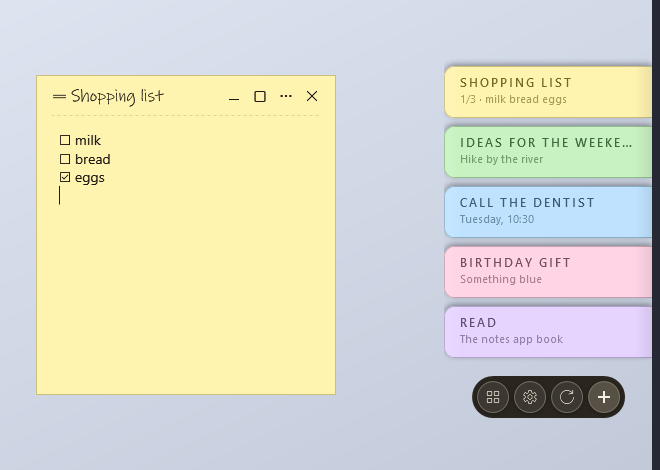
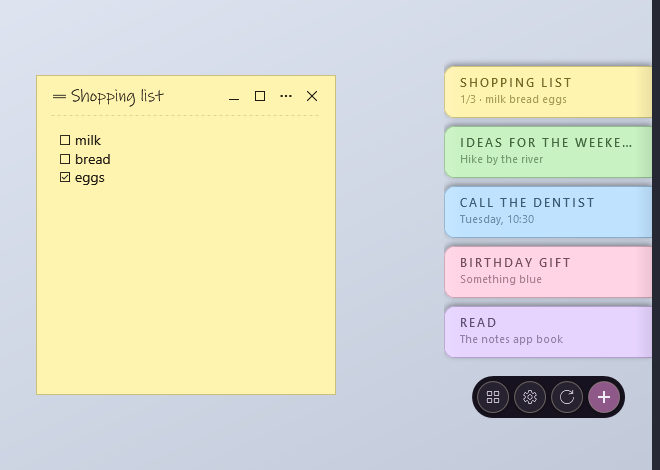
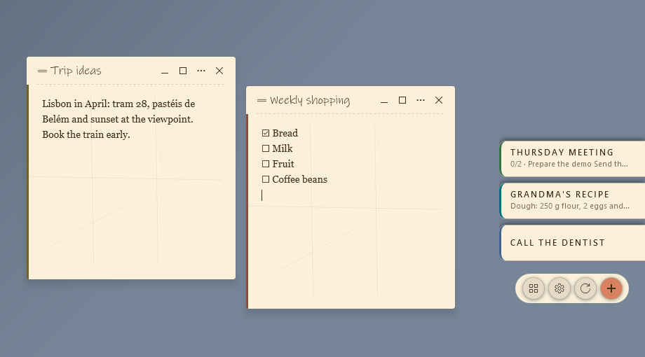
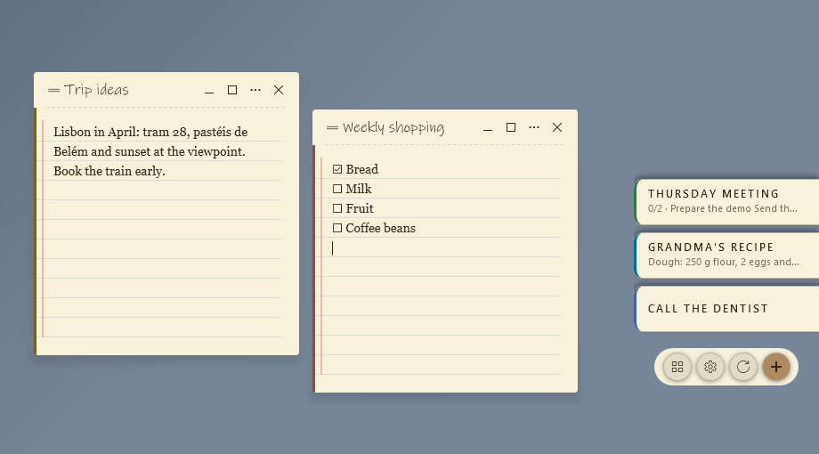
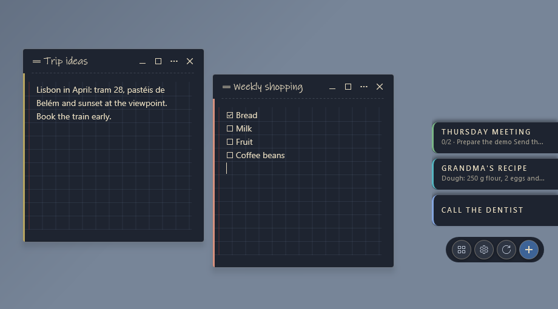
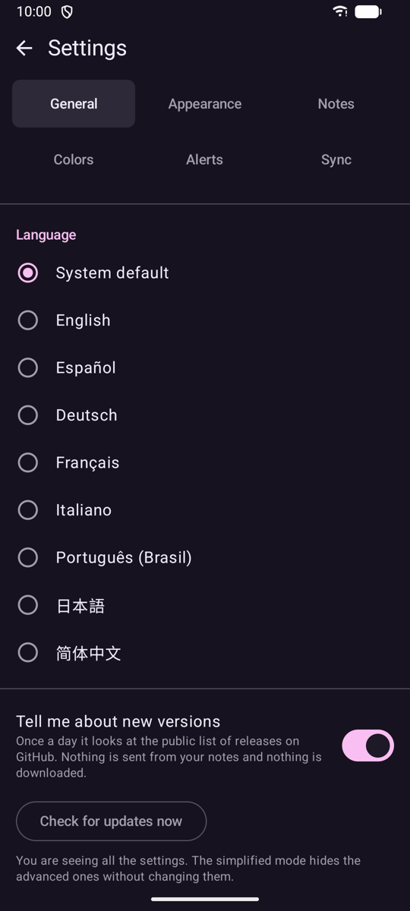

# How Aldune got here

Aldune started at the end of August 2026 as a small idea: sticky notes that live on the edge of the screen, with nothing to sign up for. This page is the short story of what it has become since, written for the people who use it (or might): what you can see, what you can trust, and the bugs that bit real users and how they were fixed.

## Then and now

| Windows 1.0.0 (24 September 2026) | Windows today |
|---|---|
|  |  |

The first screenshot uses Spanish sample notes because that is what the app was tested with at the time. Since then the dock got a quieter button bar, a text preview on each tab, pinned notes, tags and reminders on the tabs, and more than a dozen looks instead of one (the notebook looks are in the [README](../README.md#looks)).

## Five jumps you can see

Only the releases where the picture really changes are shown. Each one was made by building that very release from its tag and rendering its real windows off-screen with the same sample notes (English text, no personal data), so what you see is what that version drew. The versions in between looked the same as their neighbours.

| Version | What changed, and why it matters |
|---|---|
|  **0.5.0**, 13 September, still called Fanote | The starting point. The five tabs all read "NEW NOTE": they did not take their title from the note yet, so you could not tell notes apart without opening them. |
|  **0.8.0**, 16 September | Each tab shows the first line of its note. The dock became something you can read, not just a row of colours. |
|  **1.4.0**, 27 September | A second line on each tab with a preview and the task count ("1/3"). Often you no longer need to open the note to know what is in it. |
|  **2.5.0**, 31 October | The button bar of the dock became smaller and quieter, so the notes, not the controls, are what you see first. |
|  **2.7.3**, 1 November | The brand look: plum ink with the pink, cyan and yellow of the logo, now the default on a fresh install. |

In 0.5.0 the five tabs all read "NEW NOTE" with these sample notes. By 0.8.0, three days later, they show the first line of each note. Windows 3.0.0 looks the same as 2.7.3 in this view: what it adds (invitations, a synced look) lives in Settings and in the sync.

### Notebook looks

Since 2.1 the app can also wear the notebook looks, with paper under the text. These are three of the eleven:

| Travel notebook | Field notebook | Graph paper (dark) |
|---|---|---|
|  |  |  |

### Android

The first release candidate, 1.0.0 and today (2.0.0, in the "Aldune" look, with the list grouped by tag):

The first candidate was a plain list with a colour stripe; 1.0.0 added full-colour cards, the sync notice and the welcome message; today there is a bottom search bar with the settings gear, a preview line under each title and, if you want, sections by tag.

Settings, full screen, on 2.0.0:

## At a glance

| | Today |
|---|---|
| Platforms | Windows and Android (native Kotlin, not a wrapper) |
| Sync | your own server, a shared folder or WebDAV / Nextcloud, end-to-end encrypted |
| Languages | English, Spanish, German, French, Italian, Brazilian Portuguese, Japanese and Simplified Chinese (1.0.0 had English and Spanish) |
| Looks | the brand look "Aldune" (the default on a new install), dark, light, pastel, midnight, Windows XP and 98, Telecom, Bash, Phosphor and six notebook looks (1.0.0 had a single dark look) |
| Tasks | checklists with tick boxes, per-note rules for done tasks, progress on the tab and in the Android widget, where you can also tick them (2.7 / 1.3) |
| Servers | one sync server can host several separate stores, one per person, with a single URL (server option `ALDUNE_SYNC_SPACES`) |
| Links | `http://` and `https://` addresses in a note open with Ctrl+click (Windows, 2.4.0) |
| Safety net | automatic backups, local version history per note, password-protected notes |

## The first weeks, when it did not always work

The first public builds (0.5 to 0.10, 13 to 22 September) did what the screenshot above promises most of the time, and the rest of the time they were rough. These are real entries from the history, not a polished retelling:

| What you would have met in September | What it does now |
|---|---|
| The dock folded away while a sync was running, or right after you created a note or changed the filter, so the tab you were reaching for disappeared (0.8, 0.9) | The dock keeps a margin after a change of view, never folds while syncing and has a more generous resting zone (0.9.1) |
| Opening a note from the dock could be rude to other windows and the hover zone was too tight (0.9.1) | Opening is polite to windows already in use and the zone is larger |
| Turning a monitor off and on again could leave the dock on the wrong screen or off-screen (0.10) | Screens are identified by a stable ID, not their position in the Windows list, and the dock comes back to its own screen |
| Clicking *next to* an empty checkbox ticked it (0.10) | Only a click on the box ticks it |
| The middle-click autoscroll ran at the wrong speed and gave up when the dock fanned out (0.10) | Autoscroll steps once per screen frame and works in the dock too |
| The note menu's toggles and the dark right-click menu misbehaved (0.10.3) | Menus follow the look and close the way every other menu does |
| Accented characters were garbled in places (mojibake, fixed on 15 September) | Text is UTF-8 end to end, and files that are not UTF-8 are refused instead of damaged |
| No reminders (added 11 September), no password protection (13 September) and no sync (it arrives by 16 September) | All three exist, with signed deletions and end-to-end encryption on the sync |

Two things changed about *how* the app is made along the way. Every large change now starts with a short written specification and new logic is written test-first in a library with no interface code; and the interface is checked with disposable probes that open real windows with temporary data, click and type like a person, and save screenshots. Several of the bugs above only showed up that way.

The app also started under another name. It was renamed Aldune on 13 September, with the data folder of existing installs moved over, and the last leftovers of the old name were cleaned up in October.

## What changed, why, and how it was done

The releases that changed the most, told as ideas: what we wanted, what it became, and how it was built. The small releases in between were mostly fixes found by using the app every day.

### The dock and the note windows (0.5 to 0.10, September)

- **The idea.** A note should be one gesture away and out of the way: tabs on the edge of the screen that fan out when you reach for them, and notes that are real windows you can leave on the desktop.
- **What it became.** The dock, note windows with a header, archive and trash, a notes manager and a first sync. Most of the first weeks went into making the dock behave: not folding while you reach for a tab, remembering which screen it lives on, surviving monitors being switched off and on.
- **How.** The dock is a window that never takes focus, so it cannot steal what you are typing. When it opens and closes is decided by a small pure class (`DockHoverPolicy`) with its own tests, fed by a mouse poll, instead of by window events that fire at odd moments. Screens are identified by a stable ID, not by their position in the Windows list, which changes when a monitor is turned off.

### Sync you can trust (1.0 and 1.2, September)

- **The idea.** Sync across devices without an account and without anyone, the server included, being able to read your notes.
- **What it became.** Your own server, a shared folder, or WebDAV / Nextcloud, always end-to-end encrypted. A delete that cannot be verified never erases anything.
- **How.** Everything that leaves the device, deletions included, is encrypted with AES-GCM; deletions are signed. In 1.2 each version started to carry its author and the last version both sides agreed on, which ended the phantom conflicts, and the engine got scenario tests for the awkward cases (edit against delete, two devices offline, a changed key).

### Tasks and lists (1.1, 26 September)

- **The idea.** A shopping list you reuse every week.
- **What it became.** Tick boxes with Ctrl+Enter, "uncheck all", done tasks moving to the end, a pasted Markdown list turning into boxes, and the pending tasks inside the reminder. Later: progress on the dock tab and in the Android widget, and a per-note rule for done tasks so that a shared list is never emptied by another device (2.3).
- **How.** The text stays plain text with ☐ and ☒ glyphs, so any file or paste is still readable; the logic lives in Core with tests first. One rule came from a bug: the space right behind the glyph is part of the box, so the cursor can never end up between the box and its text.

### Looks (1.2 to 1.4, 2.1, 2.7.1)

- **The idea.** Whoever uses it decides how it looks, but a look is a skin and never an excuse to lose legibility.
- **What it became.** Light, pastel and midnight; then the retro looks (Windows XP and 98, Telecom, Bash, Phosphor); then, in 2.1, the travel, field and graph-paper notebooks with real paper under the text and their own sounds; and in 2.7.1 the brand look "Aldune" (plum ink with the pink, cyan and yellow of the logo), now the default. The "A" logo of three notes arrived on 26 October.
- **How.** Interface colours are never typed as hex in the layout: they come from named keys (`Ground`, `Text`, `Accent`...) in one palette, so every look and the live switch work, and tests fix the contrast of each text on its background. The logo and every icon come from a single script that draws the symbol as geometry, so no format is ever retouched by hand.

### Files that live on disk (1.5 to 1.7, October)

- **The idea.** Edit a `.md` or `.txt` file as if it were a note, for people whose notes already live in files.
- **What it became.** Linked notes that follow the file and the file that follows the note.
- **How.** A fingerprint of the file decides what to do: if the file is the one Aldune knows, it can write; if it changed, it is a conflict you resolve. **Aldune never deletes a linked file**, wherever it is, and in 3.0.0 it says so out loud: archiving, trashing or deleting a linked note now tells you that the file on disk was not touched.

### Android, built native (24 to 29 October)

- **The idea.** The same notes in your pocket, with the same encryption, not a wrapper.
- **What it became.** Eleven release candidates and then 1.0.0: a native app with a home-screen widget (you can tick tasks from it), a quick-capture notification and tile, reminders, tags and pairing with the PC by scanning a QR code.
- **How.** Kotlin, not MAUI, because F-Droid does not build .NET. The sync format, the encryption and the note rules are a port of the Windows library into plain Kotlin/JVM modules with no Android code in them, so they are tested on the PC. What keeps the two sides honest is a set of shared test vectors that both the C# and the Kotlin tests must reproduce: if one side changes the format, the other side's tests fail.

### Eight languages, and an accessibility pass (1.4, 2.1 to 2.4)

- **What it became.** English and Spanish at the start; German, French and Brazilian Portuguese in 1.4; Italian, Japanese and Simplified Chinese in 2.4 (these three are machine-assisted and have not been reviewed by native speakers). Visible keyboard focus, a dock you can drive with the keyboard (Ctrl+Alt+D) and contrast rules in every look arrived in 2.1.
- **How.** Every piece of interface text goes through one function that takes all the languages at once, so a missing translation is a compile error rather than a surprise, and batches of translations are checked with a script.

### The polish rounds (2.0 to 2.7, late October)

Smaller things people notice: pinned notes that sync (2.2), local version history (2.3), the mouse wheel to switch dock views and a quieter, smaller button bar (2.3 and 2.4), the view label above the notes as a control you can click (2.5 and 2.6), a "What's new" window shown once after an update, your own order for tags and safer links (2.7), and the wheel skipping empty views (2.7.2).

### 3.0.0 and Android 2.0.0 (1 November)

- **The idea.** Let the family use one server without anyone editing configuration files, and without anyone seeing anyone else's notes.
- **What it became.** Invitations. The owner makes a one-use code (with a QR code on Android); the other person pastes or scans it and gets a private space of their own. Both apps list who has joined and can revoke them. The look can follow you across devices, and the Android list can be grouped by tag.
- **How.** The server stores only hashes of codes and tokens; a code has 128 bits, expires and works once; the sync key is created on the guest's device and the server never sees it; the admin token is asked for every time and never saved. Wrong guesses are limited per address on every route.
- **The review before publishing.** Three read-only audits (server and sync, Android, and a bug hunt), with every finding checked against the code before it was fixed. They led to a cap on the number of notes per space, a look document that is never overwritten if it cannot be opened, bounded reads of server replies, a confirmation before sending an invitation or the admin token over plain `http` outside the home network, a long-press menu that works in the grouped list, and no pull-to-refresh spinner when there is no sync profile. The design pass added a text box that reaches the edges of the note (a click in the margin used to hit nothing, measured with a probe), switches filled with the accent colour, page titles in Settings that clearly stand above their sections, "Restore size and position of all notes", and colours per tag: a tag can give its colour to the notes that carry it (set in Manage tags on Windows, in the all-tags sheet on Android; the colour lands in each note, so it syncs and the sync format stays 4). A filter for notes not edited for a while was tried and dropped as noise. A last round before publishing added a search box in Settings on both apps (forgiving about typos and accents, and it takes you to the option and lights it), one red for destructive actions that is fitted to each look (measured so it reads on every background), two new note colour sets (Aldune and Jewel) with the dark looks suggesting the one that suits them, on Android notes that can be dragged to another tag and tags that stay when they are emptied, and a landscape editor whose buttons share the title row so the keyboard leaves room to write. The wheel on the dock can now leave the tags out (or only go round the tags), and Settings reflects what the dock changes, and the other way round, while it is open.

### How the work is done

- **Specification first.** Every large change starts as a short written design; new logic is written test-first in a library with no interface code.
- **Probes for the interface.** What the tests cannot see is checked with throwaway programs that open the real windows with temporary data, press real keys, measure what is under the pointer and take screenshots. Several bugs only showed up this way (a menu that would not close, a white strip when resizing, a note edge that did not respond).
- **Reviews by reading.** Before a big release, separate read-only passes look for security problems and bugs, and each finding is verified before anything changes.

## Bugs that mattered, and what changed

These are the ones a person using Aldune could actually notice. None of them is hidden: each one has a test or a probe so it does not come back.

- **Sync that invented conflicts (fixed in 1.2).** Two devices could end up arguing about a note neither had changed. Versions now carry their author and a last common version, and the engine has scenario tests for it.
- **Deletes that could take notes with them (fixed in 1.7.18 / 0.1.1).** An unsigned delete arriving from a server can no longer remove a note.
- **Credentials sent somewhere they should not go (fixed in 1.7.18 / 0.1.1).** On Android, WebDAV now refuses an address that changes host before sending the password. A pairing code or QR with a misleading address is rejected, and plain `http` outside your home network asks for confirmation.
- **Tapping a checkbox opened the keyboard (Android, fixed in 0.1.1).** A tap on a box no longer moves the cursor or pops up the keyboard.
- **A note covering the dock (fixed in 2.1.2).** A note dragged over the resting dock could hide it and you could not tell where the edge was.
- **A tray menu with unreadable text in the light XP look (fixed in 2.1.4).** Dark body, beige strip, illegible "Exit".
- **A pin that vanished on a key change (fixed before 2.2).** Re-keying a sync profile dropped optional fields such as the pin; now covered by a test.
- **A task you could not tick (fixed in the 2.3 round).** A dash glued to the box (`☐-`) made the line stop being a task. Now a sign next to the box still counts, and the space behind it is protected.
- **A dock that scrolled in jumps (fixed in the 2.3 round).** The mouse wheel moved a whole tab at a time and the middle-click autoscroll ran at an irregular rate; both are now smooth.
- **The wheel stopping at empty views (fixed in 2.7.2).** In 2.7.1 the wheel always reached Archived, Trash and All even with nothing in them; now it skips what is empty and you can leave views out.
- **Ticking the wrong task from the widget (guarded in 1.3.1).** The widget remembers where a task's box was in the note; if the note changed meanwhile (on another device, say), the tap is refused instead of ticking another task.
- **"What's new" on Android 8 (fixed in 1.3.1).** The window asked for a version number that only exists from Android 9; it now works from Android 8, the oldest the app supports.

## What keeps it trustworthy

- Everything that leaves the device is encrypted with AES-GCM, deletions included. The server only ever sees encrypted data.
- Two passes aimed at security, plus several rounds of code review, with every finding checked against the code before it was fixed.
- More than 2,000 automated tests, and the interface is checked with disposable probes that open real windows and take screenshots.
- No account, no ads, no trackers. Without sync, your notes never leave the device.

## What is next

The short version: find out from real users what is missing (several people can already share one server, each in a private space they join with an invitation), and keep the data format stable so that every version installed keeps working with the others.
